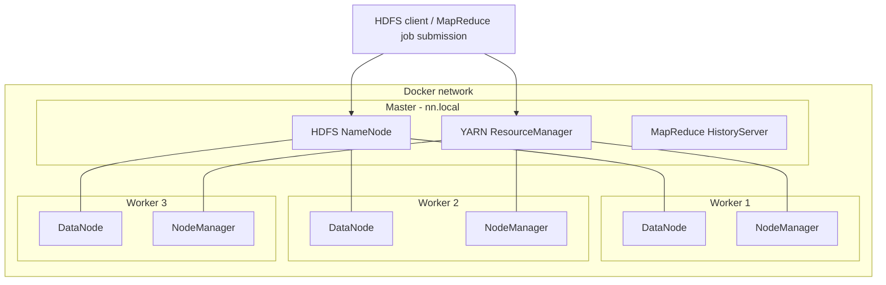

# Big Data Infrastructure Lab

A containerized development lab for exploring distributed storage, resource management, and data processing with the Apache Hadoop ecosystem. The project uses custom Docker images, explicit service configuration, and GNU Make automation to make the infrastructure understandable and reproducible.


## Overview

The main project is a multi-node Hadoop lab consisting of one master container and three worker containers. It provides an environment for exploring HDFS block replication, YARN resource management, MapReduce workloads, and the configuration of complementary big data technologies.

Rather than relying exclusively on preconfigured Hadoop images, this repository defines its own Docker images and separates master and worker configuration files. This exposes the infrastructure and configuration decisions behind a Hadoop deployment.

## Architecture



The diagram illustrates the intended core Hadoop topology. HDFS is configured for a replication factor of three. Hive, HBase, and ZooKeeper are complementary components in the Hadoop image, rather than independently verified distributed services.

## Technology stack

| Technology | Version | Role |
| --- | --- | --- |
| Apache Hadoop / HDFS | 3.3.0 | Distributed file storage and replication |
| YARN | 3.3.0 | Cluster resource management and scheduling |
| MapReduce | 3.3.0 | Distributed batch processing |
| Apache Hive | 3.1.2 | SQL-oriented analytics over Hadoop data |
| Apache HBase | 2.4.9 | NoSQL database experimentation |
| Apache ZooKeeper | 3.7.0 | Coordination service experimentation |
| ApacheDS | 2.0.0.AM26 | Separate LDAP development environment |
| Docker, GNU Make, Bash | — | Image construction and infrastructure automation |
| Java | 8 | Hadoop ecosystem runtime |

## Repository structure

```text
.
├── hadoop_three_clusters/
│   ├── Dockerfile              # Master image
│   ├── Dockerfile_datanode     # Worker image
│   ├── namenode_files/         # Master configuration
│   ├── datanode_files/         # Worker configuration
│   ├── hbase_files/            # HBase configuration
│   ├── zookeeper/              # ZooKeeper configuration
│   ├── startup_entire.sh       # Master startup
│   ├── startup_data.sh         # Worker startup
│   ├── Makefile
│   └── README.md
├── apache_ds/                  # Independent LDAP lab
├── CONTRIBUTING.md
├── LICENSE
└── README.md
```

## Getting started

Requirements: Docker, GNU Make, Bash, internet access for the initial image build, and sufficient CPU, memory, and disk space for four containers.

For the Hadoop lab, using the revised Makefile:

```bash
cd hadoop_three_clusters
make build
make start
make status
```

Verify the cluster after its services have initialized:

```bash
docker exec namenode hdfs dfsadmin -report
docker exec namenode yarn node -list
```

The intended result is three live DataNodes and three registered NodeManagers. See the [Hadoop lab documentation](hadoop_three_clusters/README.md) for component-specific instructions.

## HDFS and distributed processing examples

Run these manual smoke tests from the host after the cluster is ready.

### Store and retrieve data in HDFS

```bash
docker exec namenode bash -c 'echo "Hello Hadoop" > /tmp/demo.txt'
docker exec namenode hdfs dfs -mkdir -p /demo
docker exec namenode hdfs dfs -put -f /tmp/demo.txt /demo/
docker exec namenode hdfs dfs -cat /demo/demo.txt
```

### Inspect block replication

```bash
docker exec namenode hdfs fsck /demo/demo.txt -files -blocks -locations
```

Check whether three replicas are reported after replication has completed.

### Submit a MapReduce job to YARN

```bash
docker exec namenode hadoop jar \
  /hadoop/share/hadoop/mapreduce/hadoop-mapreduce-examples-3.3.0.jar \
  pi 4 1000
```

These examples are verification procedures, not recorded benchmark results.

## Web interfaces

With the revised localhost port mappings:

| Interface | URL |
| --- | --- |
| HDFS NameNode | http://localhost:9870 |
| YARN ResourceManager | http://localhost:8088 |
| MapReduce HistoryServer | http://localhost:19888 |

## Additional infrastructure

The repository also includes an independent [ApacheDS container](apache_ds/README.md) for LDAP directory service experimentation. It is not required to run the Hadoop lab.

## Engineering focus

- Custom container image construction and service configuration
- Multi-node HDFS topology and block replication
- YARN scheduling and distributed batch processing
- Master/worker configuration separation and infrastructure automation
- Hadoop ecosystem integration and local service experimentation

## Project scope and limitations

This is a development and learning environment, not a production Hadoop deployment. The cluster runs in containers on a single host; it does not establish physical-machine fault tolerance or production scalability. The pinned historical component versions require review before any production use. Do not expose the services to untrusted networks or store sensitive data in the lab.

Future extensions include automated cluster smoke tests, Docker Compose orchestration, distributed HBase, Spark workloads, and reproducible performance and recovery experiments.

## License

This repository is licensed under the [GNU General Public License v3](LICENSE). Third-party Apache components remain subject to their respective licenses.

